<a href="https://github.com/CSDC-K">
  <picture>
    <source media="(prefers-color-scheme: dark)" srcset="https://raw.githubusercontent.com/CSDC-K/CSDC-K/main/dark_mode.svg">
    
  </picture>
</a>

Vocational high school student from Adana, Türkiye, building backend systems, desktop tools and
autonomous robots, mostly in Rust and Python. Self-taught, and on Arch Linux / CachyOS every day.

### Projects

| Project | What it is |
|---|---|
| [Defused](https://github.com/firancly/Defused) | Hardware bomb-defusal game (Rust, Tauri, ESP32). Backend lead. 🥇 Hack Club Horizons Arcana '26 |
| [Autonomous-Vehicle](https://github.com/CSDC-K/Autonomous-Vehicle) | Self-driving car on Raspberry Pi 5 + Hailo-8L for the 18th MEB Robot Competition |
| [Trigox](https://github.com/CSDC-K/Trigox) | Desktop automation: watches files, folders and apps and runs webhooks, scripts, notifications |
| [Oryxis](https://github.com/CSDC-K/Oryxis) | Rust AI assistant that loads only the skills a request needs |
| [Makereadme](https://github.com/CSDC-K/Makereadme) | CLI that maps a project and writes its README with an LLM |
| [M.E.D.A](https://github.com/CSDC-K/M.E.D.A) | Physical-therapy app with real-time exercise tracking (Rust, Python, MediaPipe) |
| [TheSoundOfYourHardware](https://github.com/CSDC-K/TheSoundOfYourHardware) | Plays sounds when CPU, memory or temperature limits are hit |

📫 [kuzey.dev](https://kuzey.dev)
